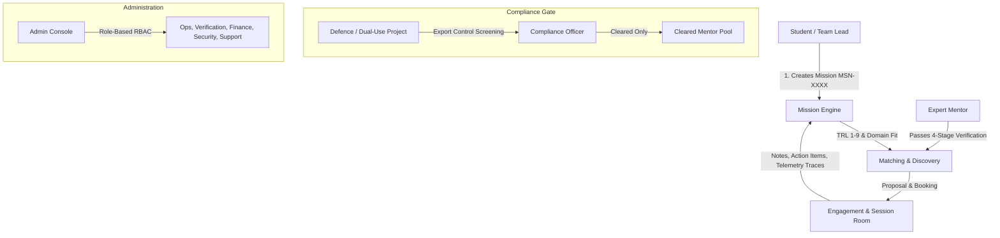

# InΦnity (Inphinity) — Comprehensive Project Evaluation & Gap Analysis

**Project Name:** InΦnity (`/home/pracxy/inphinity`)  
**Target Domain:** Expert Mentorship Marketplace for Aerospace, Deep-Tech, and Defence Hardware  
**Target Completion Date for Prototype (PDC):** 15 October 2026  
**Current State:** UI Prototype v0.1 (Next.js 16, React 19, TypeScript 5, Vanilla CSS Design System)  
**Evaluation Date:** October 2026  

---

## 1. Executive Summary & What the Project Is

**InΦnity** is a specialized, dual-sided mentorship and consultation marketplace designed specifically for student teams, university labs, and early-stage startup engineering teams building mission-critical physical hardware:
- **UAVs & Autonomous Drones**
- **CubeSats & Nanosatellites**
- **CanSats (competition/educational micro-satellites)**
- **Sounding Rockets & Propulsion Systems**
- **Avionics & Embedded Flight Software**
- **RF & Telemetry Links**
- **GNC (Guidance, Navigation, & Control)**
- **Payloads & Scientific Instrumentation**
- **Ground Segments & Mission Control**
- **Defence & Dual-Use Systems**

Unlike generic mentoring or freelancing websites (Upwork, Fiverr, Topmate), InΦnity is architected around the stringent discipline of aerospace and defence systems engineering:
1. **Technology Readiness Levels (TRL 1 through 9)** govern project maturity matching and mentor competencies.
2. **Compliance-First Security & Export Control Gates** safeguard dual-use and defence-related intellectual property.
3. **Structured Mission Lifecycles** tie engagements to Planned Dates of Completion (PDCs) and unique Mission Identifiers (`MSN-XXXX`).
4. **Three-Tier Rate Card & Engagement Modalities** (Hourly sessions, Monthly retainers, Fixed-price milestones) without public price haggling.

Currently, the repository contains a **clean, production-grade frontend prototype (v0.1)** with 19 static/dynamic routes, custom vector illustrations drawn directly in SVG, zero external UI libraries, and complete sample workflows.

---

## 2. Core Concepts & Architectural Mental Model



### Key Pillars Built into the System:

1. **NASA/DoD Technology Readiness Levels (TRL 1–9):**
   - Every mission specifies its current TRL (e.g., TRL 3: Analytical proof of concept).
   - Every mentor defines their coverage window (e.g., TRL 2 to TRL 7).
   - Prevents mismatched engagements (e.g., pairing a senior systems flight-qualification engineer with a team still formulating equations).

2. **Planned Date of Completion (PDC) & Health Tracking:**
   - Projects track status (`On track`, `At risk`, `Awaiting mentor`, `Overdue`, `Completed`) against hard launch/competition launch dates.

3. **Four-Tier Mentor Verification Pipeline:**
   - **Identity:** Government photo ID & selfie liveness check (18+ verification).
   - **Credentials:** Formal employment, academic credentials, peer-reviewed publications, and flight records.
   - **Domain Review:** 30-minute technical peer interview conducted by an approved reviewer in the exact technical discipline.
   - **Conflict & Compliance:** Conflict-of-interest check, academic integrity agreement (mentors guide and review; they never complete assessed coursework), and optional defence clearance.

4. **Dedicated Defence & Dual-Use Compliance Gate:**
   - Projects designated as dual-use or defence-related are held in administrative review.
   - Mentors must hold an explicit `defenceCleared` attribute to view or engage with these missions.
   - Mutual non-disclosure and strict export-control declarations (e.g., SCOMET in India, ITAR/EAR awareness).

---

## 3. How Well It Is Made (Quality & Technical Assessment)

### Strengths & Engineering Highlights:

| Dimension | Rating | Observation & Evidence |
|---|---|---|
| **Domain Authenticity** | **Exceptional (10/10)** | The terminology, engineering specs (CanSat envelope $\varnothing 66\text{ mm} \times 115\text{ mm}$, CubeSat $10\text{ cm}$ cube, attitude determination algorithms, Kalman filtering, LoRa/S-band link budgets) demonstrate deep, authentic understanding of aerospace workflows. |
| **Design Aesthetics & Typography** | **Outstanding (9.5/10)** | Uses an authoritative, monochrome engineering palette (`--ink: #12161b`, `--paper: #ffffff`, `--fog: #f5f6f7`). Color is strictly reserved for status pills (`--ok`, `--warn`, `--crit`, `--info`). Features Google Fonts packages (`IBM Plex Sans`, `IBM Plex Mono` for tabular telemetry/clocks, `Source Serif 4` for editorial headlines). |
| **Zero Bloat / Performance** | **Outstanding (10/10)** | Zero CSS framework overhead (no Tailwind runtime or utility baggage, no heavy component library like MUI or AntD). Hand-crafted CSS tokens with fluid typography (`clamp()`), CSS Grid, and flexbox. Entire build finishes in ~3 seconds. |
| **Procedural Vector Art** | **Superb (9.5/10)** | High-precision vector diagrams in `components/Art.tsx`: `OrbitHero` with elliptical orbital mechanics, isometric `CubeSatDiagram`, cutaway `CanSatDiagram`, quadrotor drone top-down schematics, and parabolic `TrajectoryChart` for sounding rockets. Zero external image dependencies. |
| **Type Safety & Build Integrity** | **Excellent (9/10)** | Strict TypeScript throughout. `npm run build` compiles 19 pages with 0 errors and 0 type warnings. Server-rendered routes use `generateStaticParams` for pre-rendering mentor detail pages. |
| **Accessibility & Semantics** | **Strong (8.5/10)** | Extensive use of semantic HTML (`<article>`, `<aside>`, `<figure>`, `<figcaption>`, `<dl>`, `<dt>`, `<dd>`), ARIA tags (`role="progressbar"`, `aria-pressed`, `aria-current="step"`, `aria-live="polite"`), and focus management tokens. |
| **SSR / Hydration Discipline** | **High (9/10)** | Date rendering uses fixed epoch math and a deterministic `fmtDate()` function in `lib/data.ts` to eliminate client-server hydration mismatch bugs. |

---

## 4. Current File & Directory Structure

```text
inphinity/
├── app/
│   ├── admin/page.tsx               # Role-based operations console (Ops, Verification, Finance, Security, Support)
│   ├── globals.css                  # Comprehensive design tokens, layout primitives, and component styling
│   ├── icon.svg                     # InΦnity Phi SVG brand favicon
│   ├── layout.tsx                   # Root layout importing offline font packages
│   ├── mentor/
│   │   ├── apply/page.tsx           # 5-step mentor onboarding & verification wizard (18+ check, credentials, TRL)
│   │   └── page.tsx                 # Mentor workspace (requests, active engagements, verification status, earnings)
│   ├── mentors/
│   │   ├── [id]/page.tsx            # Public mentor profile (availability heat grid, TRL scale, topics, formats)
│   │   └── page.tsx                 # Directory wrapper with domain search query support
│   ├── page.tsx                     # High-impact landing page (hero, domains, hardware diagrams, TRL, security)
│   ├── session/
│   │   └── [id]/page.tsx            # Live video session room (call controls, notes, sensor data traces, live chat)
│   ├── sign-in/page.tsx             # Interactive role selector (Student, Mentor, Staff passkey login)
│   └── student/
│       ├── new/page.tsx             # 4-step mission request wizard (TRL slider, compliance declarations)
│       └── page.tsx                 # Student dashboard (missions, PDC countdowns, next sessions, telemetry)
├── components/
│   ├── AppShell.tsx                 # Unified authenticated sidebar navigation and header
│   ├── Art.tsx                      # Procedural SVG engineering drawings & telemetry traces
│   ├── Icons.tsx                    # Minimalist SVG iconography library
│   ├── Logo.tsx                     # InΦnity brand wordmark with embedded Phi glyph
│   ├── MentorDirectory.tsx          # Client-side filtering engine (domains, TRL, verification, format, search)
│   ├── SiteFooter.tsx               # Public landing footer
│   ├── SiteHeader.tsx               # Navigation header with live telemetry UTC clock
│   ├── StatusPill.tsx               # Semantic status indicators (On track, At risk, Overdue, etc.)
│   ├── TelemetryClock.tsx           # Real-time ticking UTC clock
│   └── TrlScale.tsx                 # Visual 1–9 interactive/read-only NASA readiness bar
├── docs/
│   ├── BLUEPRINT_v2.md              # Stakeholder requirements and design decision record
│   ├── logo-sketch-from-notebook.jpg# Original notebook reference artifact
│   └── mentor_marketplace_full_chat.txt # Comprehensive platform requirements and architectural vision
├── lib/
│   └── data.ts                      # Domain models, static sample datasets, and date math helpers
├── package.json                     # Next.js 16.4, React 19.3, TypeScript 5.9, Fontsource dependencies
├── start.bat & start.sh             # Cross-platform one-click launch scripts
└── tsconfig.json                    # Path alias mappings (@/*) and strict TS compiler config
```

---

## 5. What is Missing Right Now (Gaps & Incomplete Areas)

While the prototype represents an exceptionally polished UI/UX shell, it currently operates purely on client-side state and mock data. To transform this into a functioning, scalable, compliant marketplace, the following critical components must be built:

### 1. Backend & Data Persistence
- **No Database or ORM:** There is no persistence layer (PostgreSQL, Supabase, Prisma, or Drizzle).
- **Ephemeral State:** Submitting a mission request (`/student/new`) or a mentor application (`/mentor/apply`) only updates local React state; navigating away or refreshing loses all user data.
- **Static Seed Data:** All mentors, requests, and metrics are hardcoded in `lib/data.ts`.

### 2. Authentication & Authorization (AuthN & AuthZ)
- **Mock Sign-In:** `/sign-in` has mockup buttons that redirect to `/student`, `/mentor`, or `/admin` without validating credentials.
- **No Role-Based Middleware:** Any user can manually navigate to `/admin`, `/mentor`, or `/student` directly in the browser address bar. There is no route guard or JWT/session check.
- **Passkeys / WebAuthn:** The UI refers to staff passkeys, but FIDO2/WebAuthn APIs are not yet implemented.
- **RBAC Enforcement:** The Admin console's role switcher ("Viewing as Finance Admin", etc.) is cosmetic client-side state; real backend RBAC must enforce data segregation at the database and API layer.

### 3. Real-Time Video & Media Infrastructure
- **Placeholder Video Canvas:** In `/session/[id]`, the video feed is a stylized placeholder. No WebRTC or hosted video SDK (LiveKit, Daily.co, Twilio Video, or Agora) is connected.
- **Ephemeral Session Tools:**
  - Call controls (Mute, Camera, Screen Share) do not access `navigator.mediaDevices.getUserMedia()`.
  - The live chat and session notes are stored in local React component state and will not sync between two connected participants.
  - Data tab traces are static SVGs rather than live telemetry stream sockets (WebSocket / SSE).

### 4. File Storage & Document Pipeline
- **Missing Secure Blob Storage:** File inputs on `/mentor/apply` (ID documents, degrees, publications) and `/student/new` (CAD files, sensor logs, telemetry CSVs) do not upload anywhere.
- **Dual-Use Security & Sanitization:** There is no virus scanning, DLP (Data Loss Prevention) keyword inspection, or encrypted object store (e.g., AWS S3 / Cloudflare R2 with signed URLs).

### 5. Payments, Rate Card Engine, & Escrow
- **Hidden Pricing / No Billing Engine:** The prototype specifies rate card tiers (A, B, C) and intentionally hides amounts. A complete marketplace pricing table, billing engine, and escrow flow are absent.
- **No Payment Gateway Integration:** No Stripe Connect or Razorpay Route integration for split payments, student invoicing, holding funds in escrow until milestone acceptance, mentor payouts, or refund management.
- **Tax & Regulatory Compliance:** No handling of GST (for India transactions), international VAT/sales tax, or 1099/TDS withholding.

### 6. Mentor Verification & Workflow Orchestration
- **Identity Partner API:** Identity verification is simulated; integration with automated verification providers (e.g., DigiLocker/Aadhaar in India, Persona, Stripe Identity) is required.
- **Admin Review Actions:** In `/admin`, review queue items cannot actually be approved, rejected, or sent back for amendments.
- **Scheduling & Calendar Sync:** The 15-minute intro booking and domain review slots are static strings; no calendar integration (Cal.com, Google Calendar API) exists.

### 7. SOC 2 & ISO/IEC 27001 Operational Controls
- **Audit Logging:** The admin console displays mock security events (`adminEvents`), but there is no immutable, centralized append-only audit trail capturing administrative data access, permission changes, or export-control declarations.
- **PII Masking & Privacy:** True data redaction for support staff and strict data retention policies need backend policy implementations.

---

## 6. Detailed Gap Matrix & Recommended Roadmap

```
+----------------------------------------------------------------------------------------------------+
| PHASE 1 (Current State - Done): V0.1 Interactive UI Prototype                                      |
| • 19 complete screens, TRL slider, domain filter, admin console, line art, offline font assets     |
+----------------------------------------------------------------------------------------------------+
                                             │
                                             ▼
+----------------------------------------------------------------------------------------------------+
| PHASE 2: Core Platform Infrastructure (Database, Auth & RBAC)                                      |
| • PostgreSQL schema (Students, Mentors, Missions, VerificationRecords, Engagements, AuditLogs)     |
| • NextAuth / Supabase Auth with Role-based Session Guards                                         |
| • FIDO2 / WebAuthn Passkey support for staff accounts                                             |
| • S3/R2 encrypted bucket with pre-signed URLs for mission attachments & mentor verification docs   |
+----------------------------------------------------------------------------------------------------+
                                             │
                                             ▼
+----------------------------------------------------------------------------------------------------+
| PHASE 3: Live Session Room & Verification Engine                                                   |
| • LiveKit / Daily.co WebRTC integration for 1-on-1 audio/video + screen share                      |
| • Real-time shared notes & action items via WebSockets / CRDT (Yjs)                                |
| • Persona / DigiLocker identity verification webhook pipeline                                      |
| • Admin review actions (Approve / Reject / Request More Info on mentor applications)               |
+----------------------------------------------------------------------------------------------------+
                                             │
                                             ▼
+----------------------------------------------------------------------------------------------------+
| PHASE 4: Marketplace Billing, Escrow & Compliance Certification                                    |
| • Rate card database (Tiers A, B, C hourly / monthly / fixed-price calculations)                   |
| • Razorpay Route / Stripe Connect integration with escrow release upon milestone approval         |
| • Defence compliance audit workflow with legal counsel review                                      |
| • Append-only immutable audit logging and SIEM integration ready for SOC 2 / ISO 27001 conformity |
+----------------------------------------------------------------------------------------------------+
```

---

## 7. Conclusion

**InΦnity** is built to a high standard for a V0.1 prototype. It avoids the common mistake of generic boilerplate and instead creates an **authentic, technically rigorous aerospace engineering environment**. The code is clean, modular, and performant.

The immediate next priority should be establishing the **persistence layer (PostgreSQL + Prisma/Drizzle)** and **Authentication/RBAC**, followed by the **WebRTC video provider integration** to transform this clickable interface into a functioning live platform.
